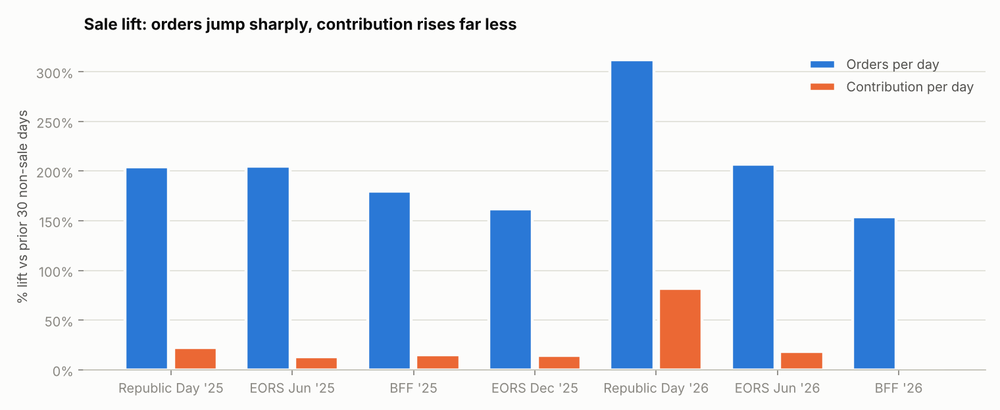
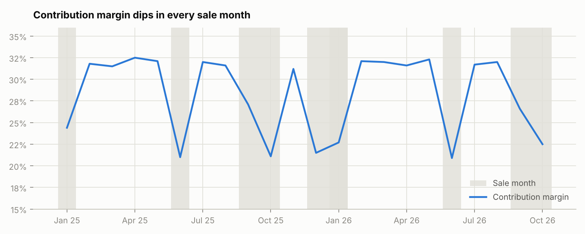
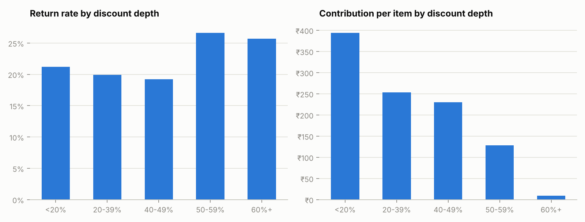
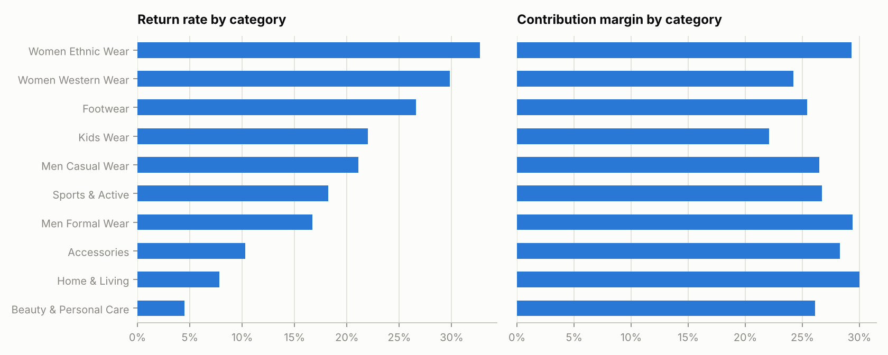
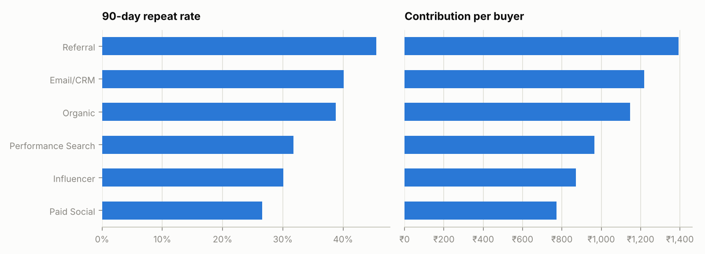
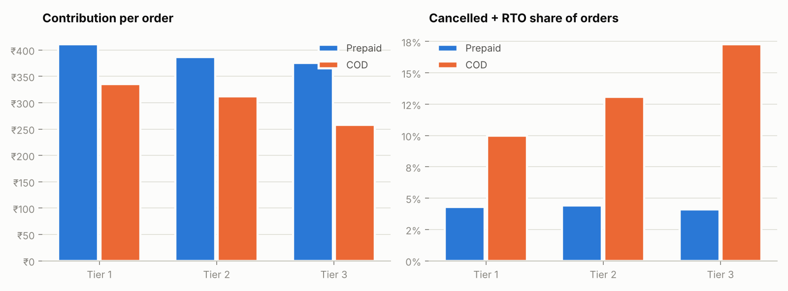

# Fashion E-commerce Analytics: Where Growth Is Profitable and Where Revenue Leaks

A business-analytics case study on a Myntra-style fashion marketplace. It answers the questions a Business Analytics team actually gets asked: *Are sales worth the margin we give up? Which categories, customers and channels make money after returns and logistics? Where does revenue leak?*

> **All data is synthetic.** It is generated by `generate_data.py` with a fixed seed and modelled on how an Indian fashion marketplace behaves (sale seasonality, COD and return-to-origin leakage, size-driven returns). No real Myntra data is used, and the magnitudes are not real Myntra figures.

**Interactive dashboard:** open [`dashboard.html`](dashboard.html) in any browser. It is a single self-contained file (works offline, supports dark mode, every chart has a table view).

| | |
|---|---|
| Period | Jan 2025 to Oct 2026 (22 months) |
| Scale | 25,000 customers (23,078 buyers), 63,656 orders, 112,567 items, 1,970 products |
| GMV / Net revenue | ₹12.07 Cr / ₹8.66 Cr (28.2% revenue leakage) |
| Item return rate | 21.9% |
| Contribution margin | 27.0% of net revenue |
| Tools | SQL (SQLite), Python (pandas, matplotlib), HTML/Chart.js dashboard, Excel export |

## Headline findings

Full write-up with evidence and actions: [`outputs/key_findings.md`](outputs/key_findings.md).

1. **Sales buy volume, not profit.** Across 7 sale windows, daily orders rose a median of 204% versus the prior 30 non-sale days, but contribution margin fell from 32% to 14% and contribution per day rose only about 15% (range 0% to +82%).
2. **Deep discounts destroy margin.** Items discounted 60%+ earn a 2.2% contribution margin versus 34.9% under 20% off, and ₹9 per item versus ₹394.
3. **Returns are a size and fit problem.** Women's ethnic wear returns 32.7% of delivered items, and size/fit drives 46% of apparel returns. Cutting size/fit returns by a fifth would lower the overall return rate by about 1.9 points.
4. **COD in smaller cities leaks revenue.** Tier 3 COD orders lose 17.3% to cancellation or RTO versus 4.1% for prepaid, and earn 31% less contribution per order.
5. **Channel quality varies a lot.** Referral buyers repeat within 90 days 45.5% of the time versus 26.6% for Paid Social, and are worth 1.8x as much per buyer.
6. **Revenue is concentrated.** Champions and Loyal customers are 26% of buyers but 58% of revenue. At Risk customers (6.2% of buyers) still hold 10.5% of revenue, which makes them the first win-back target.
7. **Private label out-earns national brands** (30.5% vs 24.5% margin) despite 52% vs 32% average discounts, because of a lower cost base. Category mix differs between the two, so treat the gap as indicative.








## Metric definitions

| Metric | Definition |
|---|---|
| GMV | Selling price of every item placed, before cancellations and returns |
| Net revenue | Selling price of items that were delivered and kept |
| Revenue leakage | 1 − net revenue ÷ GMV (cancellations, RTO, returns) |
| Contribution | Net revenue − product cost − shipping − payment fees − reverse logistics. Order-level costs are allocated to items by share of order value. Excludes marketing, tech and overheads |
| Return rate | Returned items ÷ delivered items |
| Sale lift | Per-day change versus the 30 non-sale days before each event |

## SQL queries (`sql/`)

All queries read from one view, `v_items` (`00_views.sql`), which joins orders, items, products and customers and computes item-level unit economics once.

| File | Business question | Techniques |
|---|---|---|
| `01_monthly_kpis` | How are volume, leakage, AOV and margin trending? | aggregation, conditional counts, `COUNT(DISTINCT CASE ...)` |
| `02_category_scorecard` | Which categories make money after returns? | window share of total (`SUM() OVER ()`) |
| `03_discount_efficiency` | Does a deeper discount buy profitable growth? | banding with `CASE`, margin ratios |
| `04_sale_events` | Is the sale lift worth the margin given up? | multi-step CTEs, date-window self-join baseline |
| `05_cohort_retention` | How many customers come back, month by month? | CTEs, month arithmetic, cohort pivot |
| `06_rfm_segments` | Who are the valuable and at-risk customers? | `julianday`, rule-based scoring, segment shares |
| `07_channel_quality` | Which channels bring customers worth paying for? | CTE joins, 90-day repeat logic with a maturity filter |
| `08_cod_tier_leakage` | Where do cancellations, RTO and returns concentrate? | grouped leakage by tier and payment type |
| `09_return_reasons` | Why do customers return? | `PARTITION BY` share within category |
| `10_brand_type_mix` | Do private labels earn more than national brands? | mix and margin comparison |
| `11_overall_kpis` | Headline numbers | aggregation |

## Run it

```bash
pip install -r requirements.txt
python generate_data.py     # builds data/myntra_analytics.db and data/csv/*.csv (a few seconds)
python build_report.py      # runs every query, writes charts, findings, dashboard.html, Excel tables
```

`data/csv/*.csv` and `outputs/analysis_tables.xlsx` can be loaded straight into Excel, Power BI or Tableau.

## Project layout

```
generate_data.py      synthetic data generator (seeded, reproducible)
run_queries.py        runs sql/*.sql and saves outputs/tables/*.csv
build_report.py       findings, PNG charts, Excel export, dashboard.html
sql/                  00_views.sql plus 11 analysis queries
templates/            dashboard HTML template
vendor/               Chart.js (MIT), inlined into the dashboard
outputs/              tables, charts, key_findings.md, analysis_tables.xlsx
dashboard.html        interactive dashboard
```

## Validation

Headline KPIs (GMV, net revenue, contribution, return rate, cancellation rate, order and buyer counts) were recomputed independently in pandas from the raw tables and match the SQL results exactly. Integrity checks found no orphan items, no orders without a customer, no orders before signup, and no returns on undelivered orders.

## Assumptions and limitations

- **Synthetic data.** Patterns were built in on purpose, so these are demonstrations of method, not discoveries about the real business.
- **Assumed CAC.** The channel contribution-to-CAC ratios use illustrative CAC values set at the top of `build_report.py`. They rank channels but are not real spend.
- **Sale lift is a before/after comparison.** It does not measure pull-forward demand or post-sale dips. Republic Day 2026 follows right after the December sale, so its low baseline probably inflates that event's lift.
- **Mix effects.** Discount-band and brand-type margins are partly driven by category and brand mix. A production analysis would control for this.
- **Contribution excludes** marketing, technology and overhead costs.
- Sale-event dates are illustrative, not official campaign calendars.

## How this maps to a Business Analytics internship

| Typical responsibility | Where it shows up here |
|---|---|
| Extract, clean and analyse data with SQL, Excel, Python | `sql/`, `build_report.py`, Excel export |
| Build dashboards | `dashboard.html` |
| Cost vs revenue, ROI and performance tracking | contribution model, sale-event ROI, channel contribution vs CAC |
| Supply chain, logistics and customer-experience analysis | COD and RTO leakage, delivery and return reasons |
| Cross-functional recommendations | an evidence-backed action for each finding |
